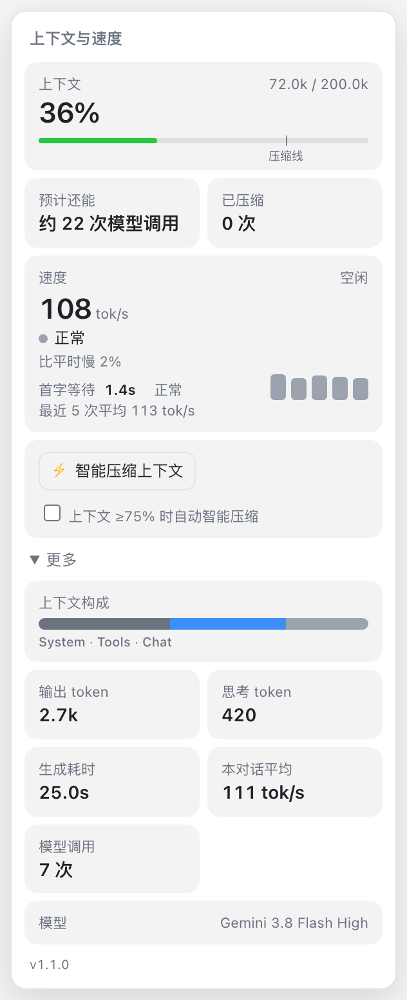
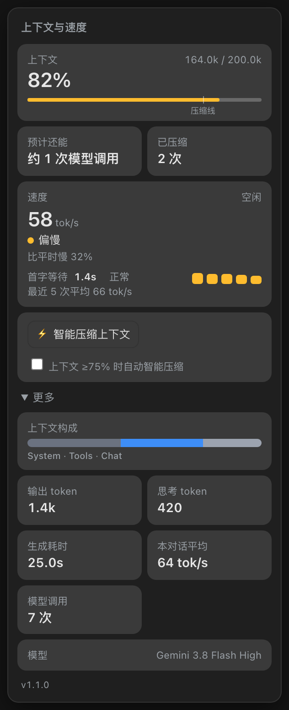
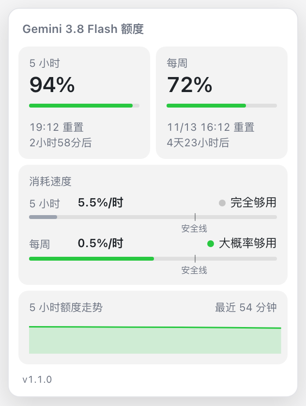
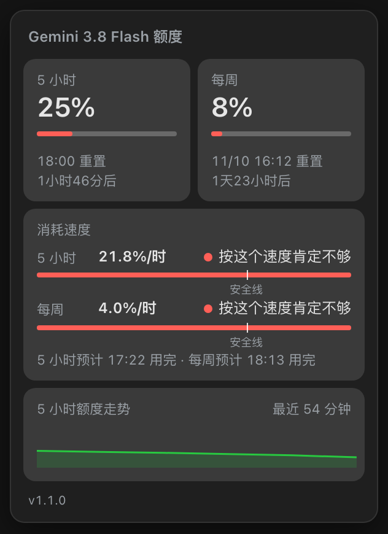

# Better Antigravity

[中文](README.md) | [English](README.en.md)

A status HUD for the Google Antigravity 2 desktop app on macOS. It puts live context-window and Gemini quota gauges next to the input box, and can compact a long conversation for you. Nothing inside the app is patched: a small injector attaches to the Chrome DevTools port that Antigravity already opens, then loads `hud.js` into the main window.

Tested with Antigravity 2.27–2.29 on macOS. After an app update, page structure or internal APIs may change and the HUD needs to be re-checked.

## Screenshots

| Normal (light) | Quota almost gone (dark) |
|---|---|
|  |  |
|  |  |

The HUD interface is currently in Chinese; these screenshots show the actual UI.

## Features

- **Context gauge.** An arc shows how much of the context window is used, with a "compaction line" at 75%. The lightning bolt in the middle fills according to output speed in tok/s. Speed is rated against the median of the last 30 calls to the same model (a fixed baseline is used until there are 5 samples), and time-to-first-token gets its own rating and a 5-call bar chart.
- **Quota gauge.** Gemini has a 5-hour limit and a weekly limit. The arc shows what is left of the 5-hour window; the stars only react to the 5-hour burn rate. A thin red ring appears outside the gauge only when the weekly burn rate means "you will definitely run out at this pace". The panel also shows the safety line, a 24-hour remaining-quota curve (broken at resets), and the next 5 reset countdowns.
- **How speed and weekly pace are measured.** The output token count reported by the model includes thinking tokens, and thinking starts during the time-to-first-token wait, so speed is total output ÷ (time to first token + streaming time). Weekly pace is the average since the current weekly cycle began (reset time minus 7 days), idle hours included, instead of extrapolating the last few busy hours across the whole week.
- **Pinned panels.** Click a gauge to pin its panel; it stays open when the pointer leaves. Click the pin again, press Esc, or click outside to close. The two panels show the HUD version and an update hint at the bottom.
- **Compaction that survives re-injection.** Progress is kept in localStorage, so a re-injected HUD continues where it left off instead of sending step 1/2 again within 30 minutes. If the AI has just written a handoff document, only step 2/2 is sent. `window.__agHud.log()` shows the last 50 events, including why the HUD was torn down.
- **Ctrl+G.** Toggles the sidebar grouping between Status and the original grouping (Project / None) by finding the app's `storageService` through the React context and changing `projectsGroupBy`.
- **Smart compaction.** Sends messages through `SendUserCascadeMessage` in the background instead of touching the input box (it falls back to typing only if that fails). The AI first writes a handoff document to `.agents/handoff/<first 8 chars of conversation ID>.md`, then runs `/compact` with an 8-section instruction, and reads the handoff back afterwards according to the global rules.

## Install

Requirements: macOS, Node.js 22 or newer, and Antigravity 2 (tested with 2.27–2.29).

One-liner:

```bash
git clone https://github.com/Flame929/better-antigravity.git ~/better-antigravity && cd ~/better-antigravity && bash install.sh
```

The installer copies the HUD to `~/.antigravity-hud` and registers a LaunchAgent that keeps it running after login. The log is at `~/.antigravity-hud/inject.log`.

Then copy the global rules (smart compaction uses them to write and read the handoff document):

```bash
mkdir -p ~/.gemini/config && cp GEMINI.md ~/.gemini/config/GEMINI.md
```

The location matters: it is `~/.gemini/config/`, **not** `~/.gemini/GEMINI.md` (the latter belongs to the old Gemini CLI and is not read by Antigravity 2).

If you want to check the HUD before letting it run all the time: open Antigravity, run `node tools/safe-inject.mjs 30` from the repository, and wait for the "✅ 通过" (passed) message before running `bash install.sh`.

## Update

```bash
cd ~/better-antigravity && git pull && bash install.sh
```

## Uninstall

```bash
cd ~/better-antigravity && bash uninstall.sh
```

This stops the injector, removes the LaunchAgent and `~/.antigravity-hud`, and removes the HUD from open windows.

## How it works

- **Debug port.** Antigravity starts with Chrome remote debugging enabled (`remote-debugging-port=0`, so the port is random). The port is written to the first line of `~/Library/Application Support/Antigravity/DevToolsActivePort`. The injector re-reads it every 3 seconds because restarts and updates change it.
- **The page.** The main window is a local page served by the language server at `https://127.0.0.1:<port>/`.
- **Language server API.** The page calls `POST /exa.language_server_pb.LanguageServerService/<Method>` with the headers `content-type: application/json`, `connect-protocol-version: 1`, and `x-codeium-csrf-token: window.__APP_CONFIG__.csrfToken`.
  - `GetUserStatus` — quota lives in `userStatus.cascadeModelConfigData.clientModelConfigs[].quotaInfo` (`remainingFraction`, `resetTime`).
  - `GetCascadeTrajectoryGeneratorMetadata` — `usage`, `streamingDuration`, and `chatStartMetadata.contextWindowMetadata` for each model call; supports incremental fetching with `generatorMetadataOffset`.
  - `GetCascadeTrajectorySteps` — steps and their state; supports `stepOffset`. A finished compaction adds a `CORTEX_STEP_TYPE_CHECKPOINT` step.
  - `GetAllRules` (with `workspaceUris`, `enablePersonal: true`) — shows the rules the app actually sees; global rules appear as `user_global`.
- **Insertion points.** The input box is `[data-testid="agent-input-box"]`; the model button is `[data-testid="model-selector-trigger"]` (wrapped in its own container).
- **Slash commands.** After typing `/compact` and pressing Enter, it becomes a tag with `data-uri="slashCommand:compact"`. Any instruction text has to be appended after the tag before sending.

## Things to know

- **DOM changes must not drive rendering.** An earlier version re-rendered on every MutationObserver callback, which changed the DOM again and froze the app (renderer at 137% CPU; force quit was the only way out). Now the observer only re-attaches when the HUD gets pushed out, and a circuit breaker unloads the HUD if it renders more than 30 times in one second.
- **"The AI finished this turn" is hard to detect.** Busy state is too fast to see, step count appears as soon as the user sends, and "all steps done" has gaps before tool calls. The HUD waits for a final text-only reply that stays unchanged for 3 seconds.
- **Typing needs a focused window.** Inserting text into the input box fails when the window is in the background; normal use goes through the button while the window is in front. For tests, enable focus emulation through CDP (`Emulation.setFocusEmulationEnabled`).
- **Run the health check after any code change.** `node tools/safe-inject.mjs 30` injects, measures page responsiveness, CPU, and layout every second for 30 seconds, and checks that the gauges are really attached.

## Files

| File | Purpose |
|---|---|
| `hud.js` | The HUD injected into the page (gauges, panels, smart compaction); safe to re-inject, a newer version replaces the old one |
| `inject.mjs` | Injector: `node inject.mjs` runs it continuously; `--once` injects once; `--remove` removes the HUD |
| `install.sh` / `uninstall.sh` | Install / uninstall the login LaunchAgent |
| `GEMINI.md` | Global rules (handoff-document convention), copied to `~/.gemini/config/GEMINI.md` |
| `tools/safe-inject.mjs` | Health check: injects, then monitors responsiveness, CPU, and layout for 30 seconds and unloads on trouble |
| `tools/cdplib.mjs` | Small CDP helper used by the health check and debugging scripts |

## License

MIT. See [LICENSE](LICENSE).
